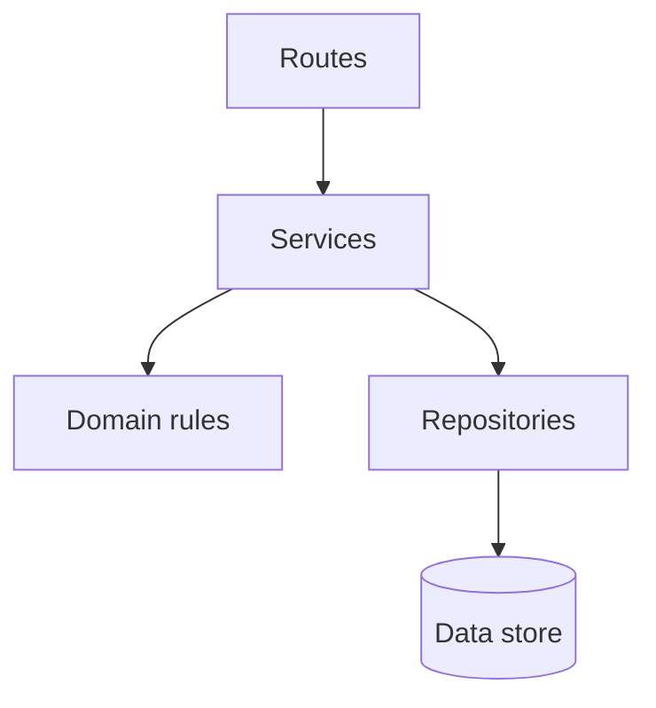
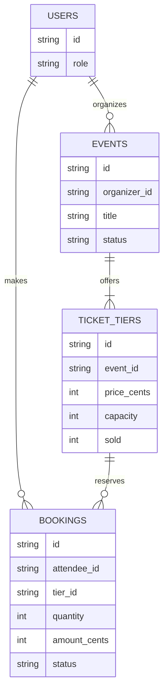
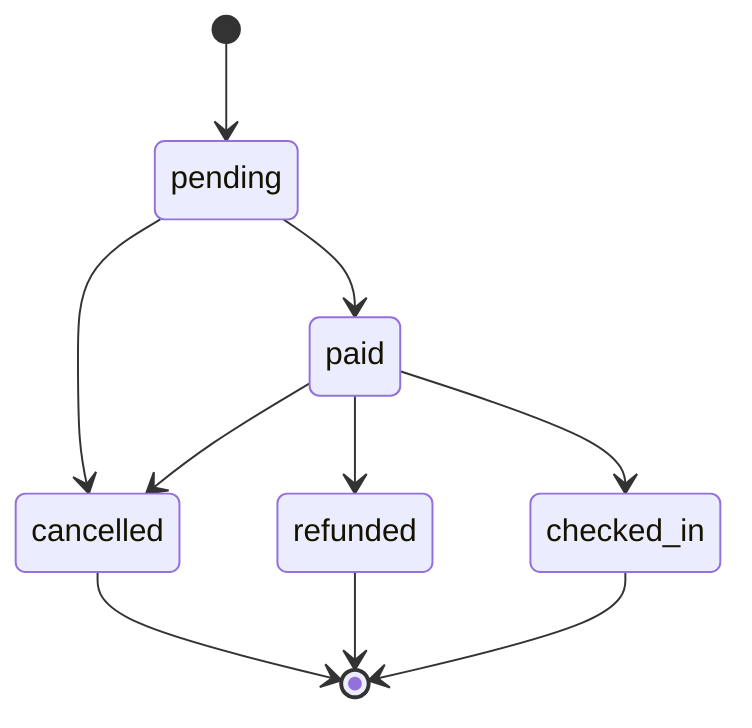

# Architecture

## Layers

- **Routes** translate HTTP requests and responses. They may call services, but may not contain business rules or access data directly.
- **Services** coordinate use cases. They may call domain rules and repositories, but may not depend on routes or HTTP details.
- **Domain rules** enforce business invariants. They may depend on neither HTTP nor storage.
- **Repositories** read and write data. They may depend on storage, but may not call services or routes.
- **Data store** persists records. It does not call application layers.

## Data model

## Booking life cycle

